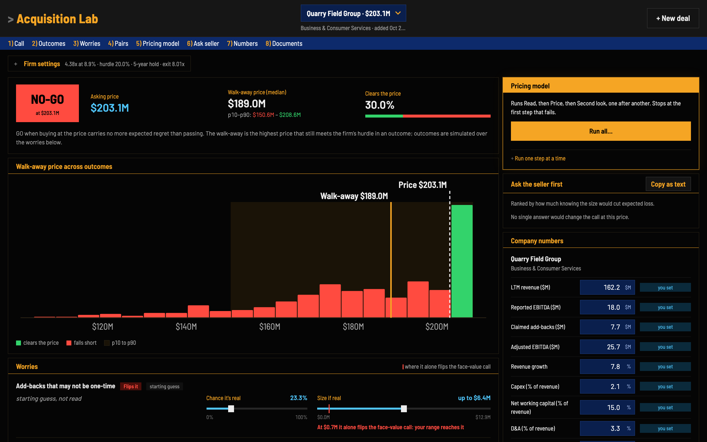
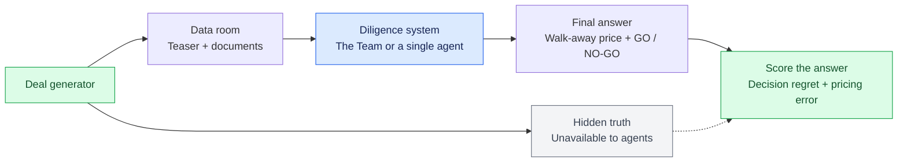
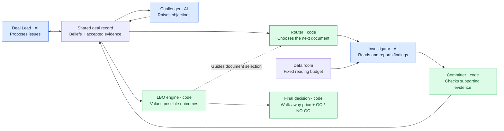

# Acquisition Lab

**A team of AI agents that does buyout diligence: it decides what to read, finds what the teaser hides, and makes
the go/no-go call.**

Acquisition Lab generates synthetic private-equity deals whose data rooms hide real problems. It gives AI systems a
fixed reading budget and scores each go/no-go call against the hidden truth.

The **analyst board** puts the same engine in front of an analyst. Drop in a teaser and CIM, and it shows the call at
the asking price, which worries could flip it, and what to ask the seller first. Drag any chance or size to see the
call change live.



## The problem

A teaser shows revenue, adjusted EBITDA, an asking price and a lender term sheet. The data room behind it may hide a
recurring "one-off" add-back, an earnout or unfunded pension, a customer about to leave, skipped capex or pending
litigation. Lenders size debt as a multiple of EBITDA, so one small fact can flip the deal. An analyst can't read
everything, so the job is to **choose what to read**, then decide whether to buy and what to pay at most.

## How it works



Listing the data room is free; every search and document read costs budget.

- **Deal generator** (`acqlab/generator`): plants 2–5 hidden facts per deal (decision flips, decoys, interacting
  issues, unresolvable questions) and checks that each one can be recovered from the documents.
- **LBO engine** (`acqlab/engine`): sizes the debt and finds the **walk-away price**, the highest price that still
  clears a 20% IRR hurdle. It is the only source of financial numbers, so the AI never does scored arithmetic.
- **The opponent:** one Claude agent with the same tools, the same budget and the engine as a tool.

### Inside the Team

Blue is AI, green is code.



The Committer accepts a finding only if it is quoted from a document, computed from quotes, or recorded as a conflict
between documents.

## Results

160 fresh test deals, every system on the same Claude model, with the rules fixed before the deals were generated.

| System | Decision regret (lower is better) |
|---|---|
| **The Team** | **0.0088** |
| Best of 2 single-agent runs | 0.0105 |
| Single agent | 0.0126 |
| Engine on the teaser alone | 0.0356 |

*Decision regret is the overpayment on a bad deal bought, or the value forgone on a good deal passed, divided by the
asking price.*

- **30% lower regret than a single agent**, and lower than two single-agent runs voting.
- **About two-thirds lower regret on the hardest deals.** On the 79 deals where the documents reverse what the teaser
  suggests, the Team's regret is 0.0072 against the single agent's 0.0224.
- **The clearest win is on interacting issues**, where two problems only matter together. Here the gain is
  statistically clear.
- **The engine cuts pricing error by over a third** compared with letting the AI value the deal itself.
- **The edge isn't just caution.** Making the single agent say NO-GO as often as the Team makes it worse, not better.

Full results: [docs/results/plan-6-main-run.md](docs/results/plan-6-main-run.md).

## Getting started

You need Python 3.12+ and [uv](https://docs.astral.sh/uv/).

```bash
git clone https://github.com/dmbritton1/Acquisition-Lab.git
cd Acquisition-Lab
uv sync
uv run pytest -q
```

Generate a few deals (free, offline):

```bash
uv run python -m acqlab.generator.batch --out data/demo --dev 5 --test 0 --hand 0 --showcase 0
```

Each deal's documents land in `data/demo/deals/<id>/room/`, and its hidden answer in `data/demo/truth/<id>.json`.

Run the AI systems on them. This uses the [Claude Code](https://claude.com/claude-code) CLI and costs real usage,
so it refuses to start without `--confirm-claude`:

```bash
uv run python -m acqlab.bench.pilot --data data/demo --n 5 --systems s1b,s4 --confirm-claude
uv run python -m acqlab.bench.pilot --data data/demo --n 5 --systems s1b,s4 --report
```

### Run the analyst board

Make a sample deal from one of the generated rooms, then start the board. Its data folder must sit outside the
repository:

```bash
uv run python scripts/board_sample.py --room data/demo/deals/dev-000/room --home ~/AcqLab
uv run python -m acqlab.app --home ~/AcqLab
```

Open http://127.0.0.1:8765. The board, the sample deal and the live drags are free. The **Read**, **Price** and
**Second look** steps call Claude through the [Claude Code](https://claude.com/claude-code) CLI and use your own
Claude usage. Deals are saved only on your machine.

## Repository map

| Path | Contents |
|---|---|
| `acqlab/engine/` | LBO model, debt sizing, walk-away price |
| `acqlab/generator/` | Deal sampler, hidden-fact library, document rendering and checks |
| `acqlab/dataroom/` | The budgeted tools every system shares |
| `acqlab/app/` | The analyst board: local server and web page |
| `acqlab/agents/` | The Team, the single agent, the Committer |
| `acqlab/routers/` | Code routers that price the next read |
| `acqlab/bench/` | Runners, campaign, analysis |
| `docs/` | Design specs, pre-registrations and results |

## Limits

- At 160 deals, the overall 30% difference is not statistically significant (95% CI −0.0100 to +0.0016). The
  significant gain is on interacting issues.
- The Team does worse than the single agent on decoy-heavy deals and reads more pages in total.
- The deals are synthetic. The ranges are drawn from mid-market LBO sources, but the documents are generated.
- The engine tests covenants annually, uses a single term loan and fixes the exit multiple.
- Every system ran on one model family (Claude).
